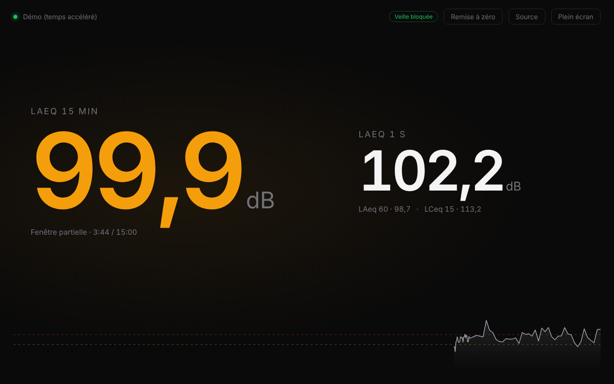
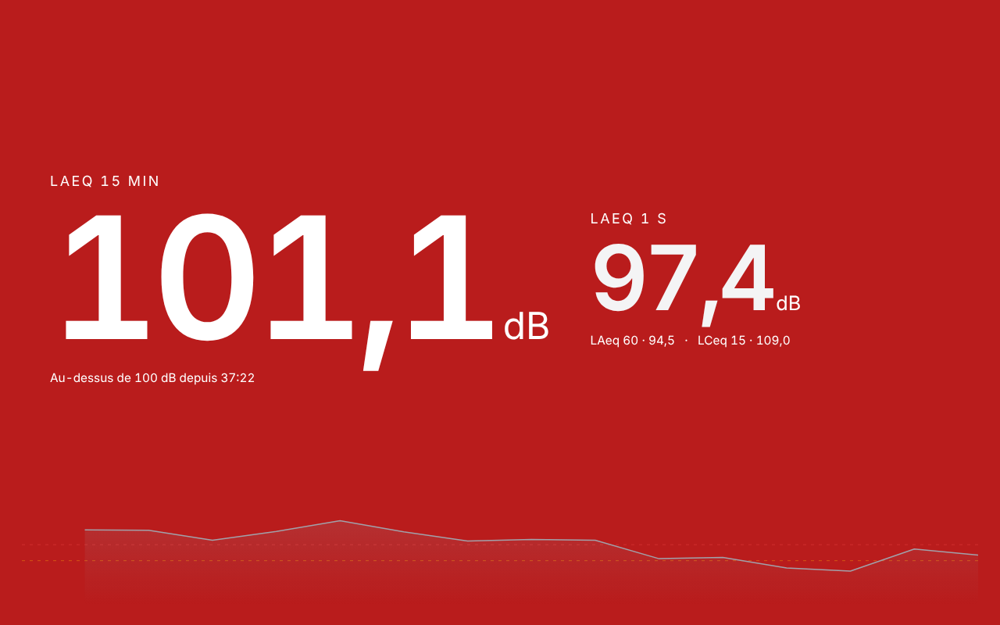
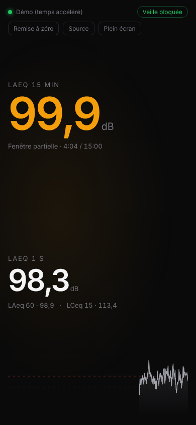

# 10EaZy Display

Un affichage plein écran, lisible de loin, pour les mesures de niveau sonore d'un système **10EaZy**. Il remplace le *WebViewer* d'origine.

Il affiche le **LAeq 15 min** en très grand, avec un code couleur, et lance une **alarme visuelle** en cas de dépassement prolongé. Il est conçu pour une tablette posée à la régie ou sur scène.



| Dépassement prolongé | Sur téléphone |
|---|---|
|  |  |

## Fonctionnalités

- **LAeq 15 min** en grand, avec le code couleur suivant :
  - 🟢 vert : niveau OK
  - 🟠 orange : au-dessus de **96 dB(A)**
  - 🔴 rouge : au-dessus de **100 dB(A)**
- **Alarme** : l'écran clignote en rouge après **5 minutes** au-dessus de 100 dB(A).
- **LAeq 1 s**, plus LAeq 60 min et LCeq 15 min en complément.
- **Courbe** des 15 dernières minutes avec les seuils.
- **Plein écran** (bouton ou touche `F`). La barre du haut se masque toute seule.
- **Anti-veille** pour tablettes et téléphones.
- **Perte de données signalée** : si 10EaZy ne répond plus, les chiffres s'estompent et un message s'affiche. Un écran figé ne peut donc pas passer pour une mesure en cours.
- **Accessible depuis n'importe quel appareil** du réseau local, sans rien installer dessus.
- **Mode démo** pour tester sans système 10EaZy.

## Comment ça marche

Le WebViewer de 10EaZy ne transmet aucune donnée numérique. Il recharge en boucle une **image du panneau LabVIEW** à l'adresse suivante :

```
http://<IP>/.snap?10EaZy%20Development.lvproj/My%20Computer/Remote_Panel.vi&
```

`server.py` télécharge cette image chaque seconde et **lit les six grandes valeurs** dessus. La lecture se fait par comparaison avec des gabarits de chiffres intégrés au script, sans OCR externe. Le serveur republie ensuite les valeurs vers le navigateur en temps réel, par Server-Sent Events.

```
PC 10EaZy ──image du panneau──▶ server.py ──valeurs (SSE)──▶ navigateur / tablette
```

Valeurs lues sur le panneau : LAeq 1 s, LAeq 15 min, LAeq 60 min, LCeq 1 s, LCeq 15 min, LCeq 60 min.

## Installation

Prérequis : **Python 3.9+** et **Pillow**.

```bash
git clone https://github.com/kazenotodoroki/10eazy-display.git
cd 10eazy-display
pip install -r requirements.txt
```

## Utilisation

```bash
# Connexion au PC qui fait tourner 10EaZy
python server.py --ip <IP-de-la-machine>

# Ou sans IP : elle se saisit dans l'interface (bouton « Source »)
python server.py

# Démo avec données simulées (temps accéléré x10)
python server.py --demo
```

Ouvre ensuite :

- sur la même machine : <http://localhost:8080>
- depuis une tablette ou un autre PC : `http://<IP-de-la-machine>:8080` (l'adresse s'affiche au démarrage)

| Option | Description |
|---|---|
| `--ip IP[:port]` | Adresse du PC 10EaZy |
| `--port N` | Port du tableau de bord (8080 par défaut) |
| `--demo` | Données simulées |
| `--speed N` | Accélération du temps en démo (10 par défaut) |
| `--test IMAGE` | Lit une capture du panneau et affiche les valeurs reconnues |

### Sur l'interface

| Action | Effet |
|---|---|
| **Source** | Saisir ou changer l'IP du PC 10EaZy |
| **Remise à zéro** | Vider la courbe et relancer le compteur de dépassement (le LAeq 15 reste celui de 10EaZy) |
| **Plein écran** / touche `F` | Basculer en plein écran |

## Tablette : empêcher la mise en veille

La page bloque la mise en veille toute seule. Il faut **toucher l'écran une fois** après l'ouverture ; la pastille « Veille bloquée » confirme que c'est actif.

Pour une tablette dédiée, il vaut mieux régler aussi le système :

- **iPad** : Réglages → Luminosité et affichage → Verrouillage automatique → **Jamais**
- **Android** : Options pour les développeurs → **Rester activé** (l'écran reste allumé pendant la charge)

## Configuration

Les réglages se trouvent en haut de `server.py` :

```python
ORANGE_DB = 96.0          # LAeq 15 au-dessus -> orange
RED_DB = 100.0            # LAeq 15 au-dessus -> rouge
ALARM_AFTER_S = 5 * 60    # rouge depuis 5 min -> clignotement
POLL_S = 1.0              # fréquence de lecture du panneau (secondes)
```

Si le PC 10EaZy semble ralentir, passe `POLL_S` à `2`.

## Dépannage

**« Plus de données de 10EaZy »**
- Vérifie que le PC 10EaZy est joignable : ouvre l'URL `.snap` ci-dessus dans un navigateur. Le panneau doit s'afficher seul.
- Vérifie que l'IP saisie est la bonne (bouton **Source**).

**« Panneau non reconnu » ou « lecture douteuse »**
- Enregistre l'image du panneau (clic droit → Enregistrer l'image), puis lance :
  ```bash
  python server.py --test capture.png
  ```
- Si les valeurs sont fausses, la mise en page du panneau a probablement changé, par exemple après une mise à jour de 10EaZy. Les gabarits de chiffres et la zone de lecture (`BAND`, `DIGIT_Y`, `DIGITS`) devront alors être recalibrés.

**La tablette se met quand même en veille**
- Touche l'écran une fois après le chargement de la page, puis applique le réglage système décrit plus haut.

## Structure

```
server.py        Serveur relais : lecture du panneau, calculs, API, SSE
dashboard.html   Interface (HTML/CSS/JS, sans dépendance externe)
docs/            Captures d'écran
```

### API

| Route | Description |
|---|---|
| `GET /` | Interface |
| `GET /events` | Flux temps réel (Server-Sent Events) |
| `GET /api/state` | État courant (JSON) |
| `GET /api/history` | Historique des 15 dernières minutes |
| `POST /api/config` | `{"host": "<IP-de-la-machine>"}` |
| `POST /api/reset` | Remise à zéro |

## Avertissement

Ce projet est **indépendant** : il n'est ni affilié ni approuvé par 10EaZy ou Rational Acoustics. Il ne fait que **recopier les valeurs** que 10EaZy affiche. Il ne constitue pas un instrument de mesure. Les valeurs de référence, notamment pour la conformité réglementaire, restent celles du logiciel 10EaZy et de ses journaux.

## Licence

MIT
